# Introducción a Markdown

## Índice

- [Un poco de historia](#un-poco-de-historia)
- [¿Dónde aparece por primera vez?](#dónde-aparece-por-primera-vez)
- [Algunos ejemplos de editores WYSIWYG](#algunos-ejemplos-de-editores-wysiwyg)
- [¿Por qué Markdown si ya existían editores de HTML?](#por-qué-markdown-si-ya-existían-editores-de-html)
- [¿Cuál era el proceso de publicación en Blogger?](#cuál-era-el-proceso-de-publicación-en-blogger)
- [Formatos previos a Markdown](#formatos-previos-a-markdown)
- [¿Qué problemas resuelve Markdown?](#qué-problemas-resuelve-markdown)
- [Sintaxis y marcas de Markdown](#sintaxis-y-marcas-de-markdown)
- [Tareas:](#tareas)
- [Referencias](#referencias)
- [Editores online](#editores-online-markdown)

## Un poco de historia
A principios de los años 2000, plataformas como Blogger ya permitían publicar artículos en Internet sin necesidad de programar páginas HTML. Sin embargo, algunos autores, especialmente desarrolladores y escritores técnicos, preferían redactar sus textos con editores externos y controlar directamente el formato de sus publicaciones.

Uno de ellos era John Gruber, creador del blog Daring Fireball. Gruber utilizaba Movable Type y redactaba sus artículos en HTML, lo que le obligaba a alternar entre el editor de texto y el navegador para comprobar el resultado > Proceso repetitivo de edición, previsualización y corrección > pérdida de tiempo

Inicialmente, Markdown se distribuyó como una herramienta escrita en Perl que podía instalarse como complemento de plataformas como Movable Type y Blosxom. Al publicar un artículo, el sistema transformaba automáticamente el texto Markdown en HTML.

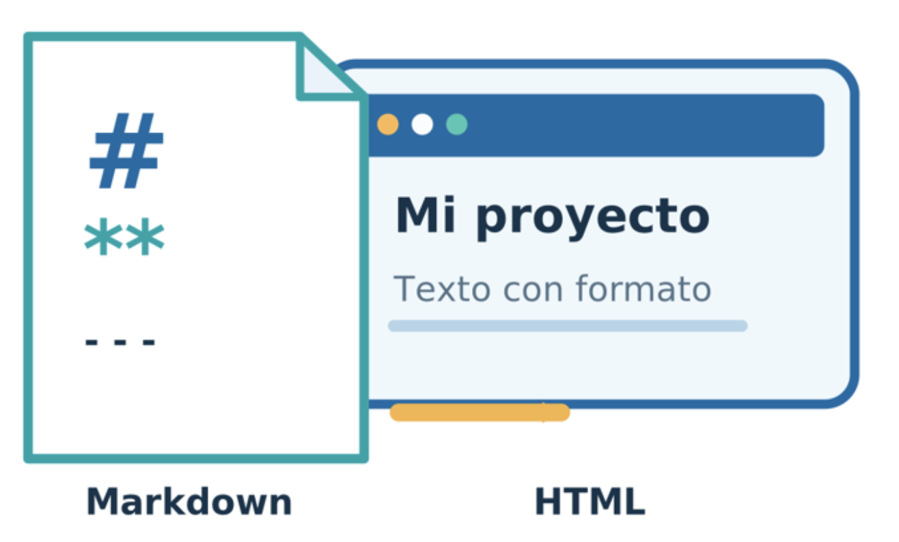

Por tanto, **Markdown no surgió para hacer posible la publicación de blogs sin conocimientos de programación**, algo que Blogger ya facilitaba, sino para ofrecer una alternativa más cómoda, legible y flexible a la escritura directa en HTML.
- **Antecedentes** **(2003)**: HTML, Setext, Textile, los sistemas wiki y los correos electrónicos en texto plano aportan distintas ideas de marcado.
- **Nacimiento de Markdown** **(2004):** ****Publicación versiones iniciales, lanzamiento de Markdown 1.0 en agosto.
- **Finales de los 2004**, se hace muy popular: Servicios como GitHub incorporan Markdown para documentación, archivos README.md
- **CommonMark** **(2014):** Se desarrolla una especificación más precisa para reducir las diferencias entre implementaciones de Markdown.

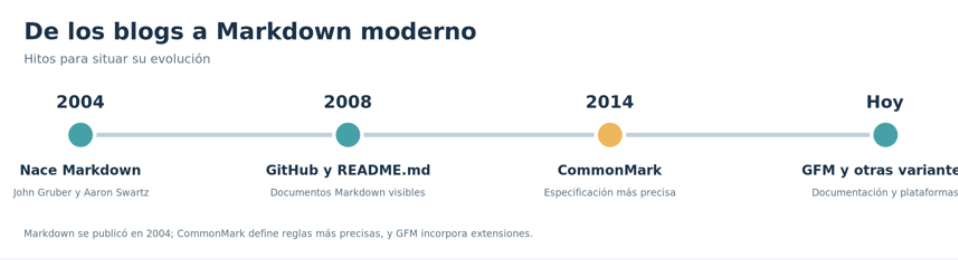

CommonMark es una especificación de Markdown creada en 2014 para establecer reglas claras y comunes sobre cómo interpretar los documentos Markdown, mejorando la especificación original de 20024.

Markdown evoluciona hasta nuestros días:
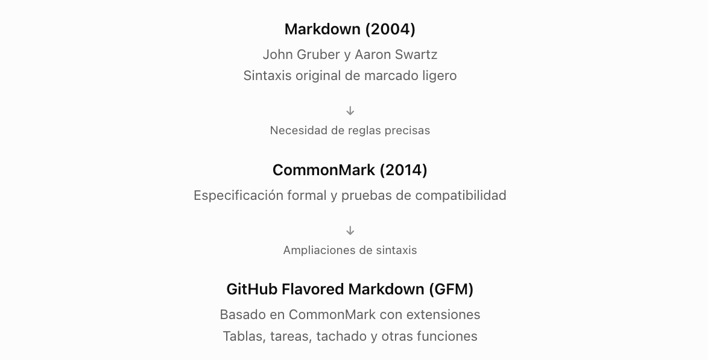

Características Markdown original y versiones Github GFM:
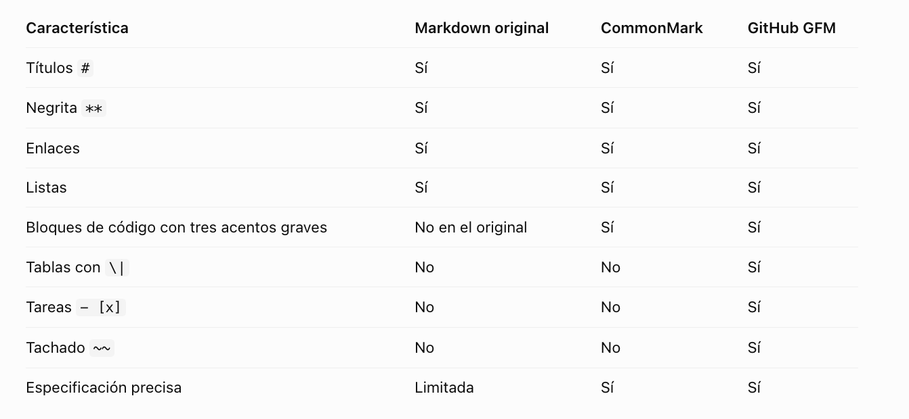

**Actualmente:** Markdown se utiliza en documentación de software, repositorios, cuadernos de notas, sistemas de publicación, herramientas de desarrollo y aplicaciones de IA.

Su principal aportación consistió en separar la escritura del contenido de su representación final en una página web.

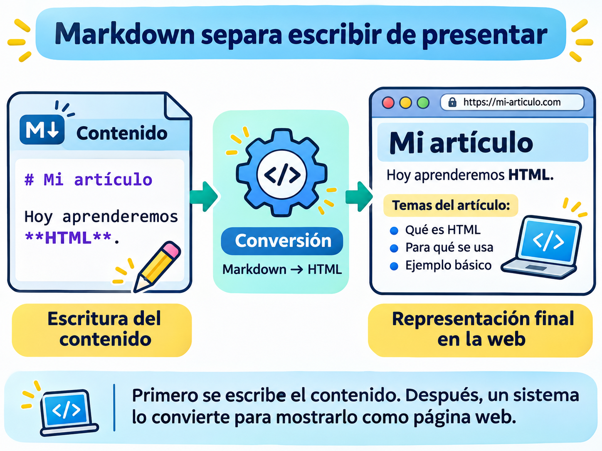

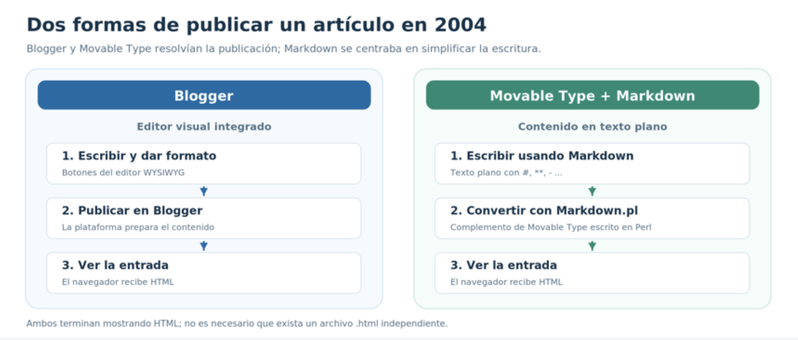

En aquel tiempo, una persona que quería publicar un artículo en Internet tenía principalmente dos opciones:

- Escribir HTML: conocer las etiquetas necesarias para crear títulos, párrafos, enlaces y listas.
  - Inconveniente: Debe conocer las etiquetas y es lento de formatear.
- Utilizar un editor visual (WYSIWYG): escribir y dar formato al contenido de forma parecida a un procesador de textos, aunque el HTML generado podía resultar difícil de modificar.

  - Eran editores que te permitían escribir texto y convertirlo a HTML
  - Uno de los más utilizados era Dreamweaver y otros como:

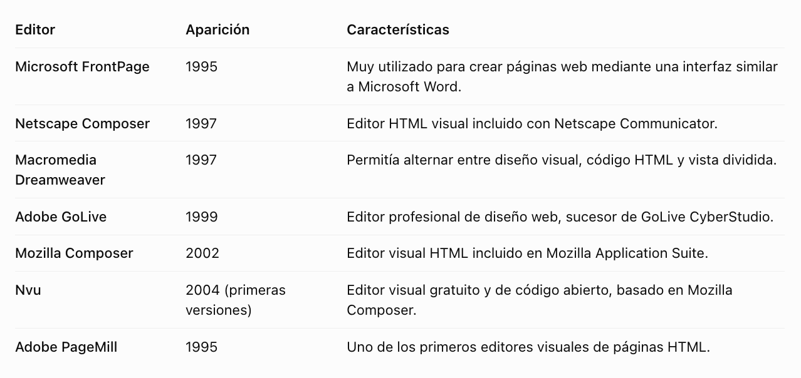

Ambas opciones funcionaban, pero había un problema: la estructura técnica del documento podía distraer al autor de lo más importante, que era escribir su contenido.

Ejemplo: imaginemos que en 2003 un profesor quiere publicar lo siguiente:

- Mis apuntes de informática
- Hoy aprenderemos HTML y sus principales características.

Para hacerlo directamente en HTML, podría escribir:

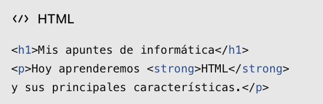

Pero se quería usar un formato más sencillo, que no complicara la estructura:

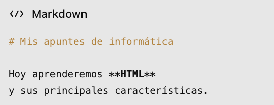

¿Observas la diferencia a simple vista?

El contenido se entiende perfectamente sin necesidad de convertirlo en página web, hay algunos símbolos que se añaden para representar formato, pero no distraen del contenido principal.

**Markdown**: Creación en 2004, su objetivo era crear documentos fáciles de escribir, fáciles de leer y que un programa pueda convertirlo automáticamente en HTML.

Los creadores fueron:

John Gruber:
- Periodista tecnológico, escritor y desarrollador estadounidense, creador del blog Daring Fireball.
- Ideó Markdown y programó la primera herramienta de conversión a HTML, utilizando el lenguaje Perl.
  
Aaron Swartz (1986–2013):
- Programador y activista de Internet, conocido por su defensa del acceso libre al conocimiento.
- Colaboró en el diseño y las pruebas de Markdown, y desarrolló herramientas para la conversión de HTML a texto.

Su objetivo no era reemplazar HTML, sino conseguir que los autores pudieran escribir documentos estructurados sin preocuparse continuamente por sus etiquetas.

## ¿Dónde aparece por primera vez?
15 de marzo de 2004. John Gruber anuncia públicamente Markdown en su blog Daring Fireball mediante el artículo Introducing Markdown.

Markdown se distribuyó inicialmente como herramienta de publicación para blogs, especialmente mediante complementos de Movable Type y Blosxom. Por lo tanto, Markdown nació principalmente para facilitar la redacción y publicación de artículos en blogs y páginas web, mucho antes de convertirse en un formato habitual de documentación informática.

## Algunos ejemplos de editores WYSIWYG
Aquí puedes ver qué herramientas se utilizaban para crear páginas HTML, en orden: Microsoft FrontPage, Macromedia Dreamweaver y Netscape Composer.

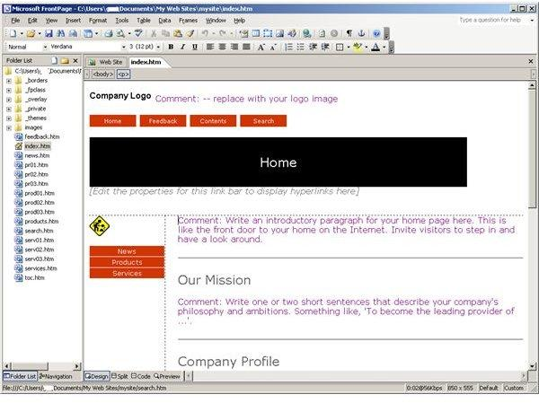

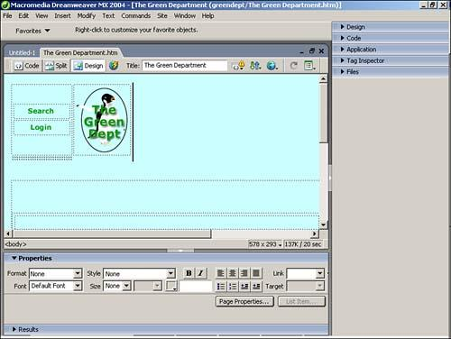

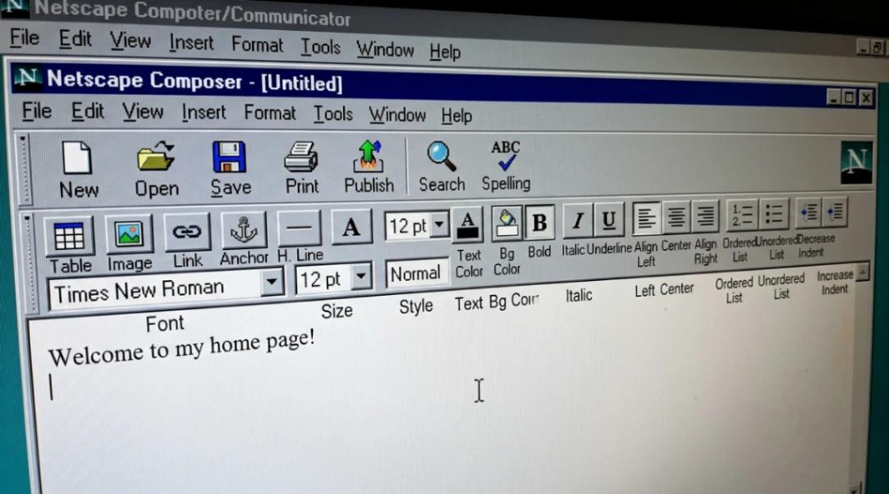

## ¿Por qué Markdown si ya existían editores de HTML?
Este punto es muy interesante, porque llegados a este punto, ya teníamos las herramientas “traductoras” del texto que tomaban por un lado el texto que escribía el usuario y lo convertía a código HTML para publicarlo en la web.

También se podía publicar un contenido en texto plano .txt, pero no tenía ningún tipo de formato y es por ello, que debía pasar por un editor de HTML para añadirle las etiquetas o enriquecerlo para que los navegadores pudieran interpretar y darle formato, estructura, enlaces, imágenes, encabezados, etc.

No es imprescindible pasar un archivo .txt por un editor HTML para publicarlo: un navegador puede mostrar texto plano. Lo que sucede es que el TXT no dispone de etiquetas HTML para expresar la estructura semántica o los enlaces.

Los editores WYSIWYG resolvían el problema de crear páginas web sin escribir manualmente HTML, pero tenían algunas limitaciones:

- Podían generar código HTML innecesariamente complejo >> tiempo de carga mayor
- En ocasiones, el resultado visual variaba entre navegadores.
- Algunos requerían instalar software específico.
- El autor podía perder el control directo sobre el código generado.
- Para publicar artículos sencillos, ofrecían mucha complejidad.

Markdown propuso otra solución: en lugar de utilizar un editor visual complejo, escribir documentos sencillos en texto plano, comprensibles para cualquier persona y convertibles automáticamente a HTML.

**Ventaja**: No necesito un editor complejo, cualquier editor de texto sencillo sirve para crear y editar ficheros Markdown.

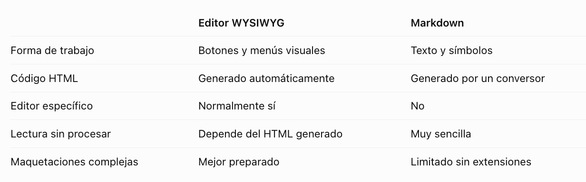

Aquí puedes ver las diferencias entre usar un editor HTML y trabajar en formato Markdown, debes tener en cuenta que el editor está orientado a crear páginas web y un sitio completo (un CMS es una evolución natural de este tipo de editores en la nube), pero Markdown está enfocado en crear contenido y convertirlo a HTML para que se pueda leer en Internet de manera sencilla:

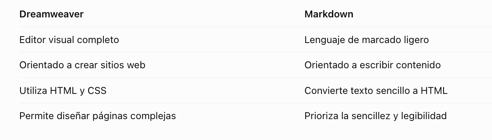

**Revisar:** Un CMS no es exactamente una evolución de los editores WYSIWYG. Es un sistema para gestionar y publicar contenido, que puede incorporar un editor visual.

## ¿Cuál era el proceso de publicación en Blogger?
Tu experiencia con Blogger es correcta y permite aclarar un aspecto importante de la historia de Markdown: en 2004 no era necesario conocer HTML ni utilizar Markdown para publicar en un blog, de hecho, fue un punto de inflexión, democratizando la publicación web (cualquiera podía hacerlo sin conocimientos de HTML).

Blogger ya permitía escribir artículos desde una interfaz web (podemos hablar de un primitivo CMS) y publicarlos directamente. Markdown nació para resolver un problema más específico: facilitar la escritura y edición de contenidos en texto plano, especialmente entre quienes utilizaban HTML para preparar sus publicaciones.

En aquella época coexistían dos enfoques:

- Blogger: escribías el artículo en la plataforma, utilizabas sus herramientas de edición y pulsabas “Publicar” y listo.
- Markdown con Movable Type o Blosxom: escribías el contenido utilizando una sintaxis de texto plano y un complemento lo convertía automáticamente en HTML durante el proceso de publicación.

Se puede ver el proceso de conversión:

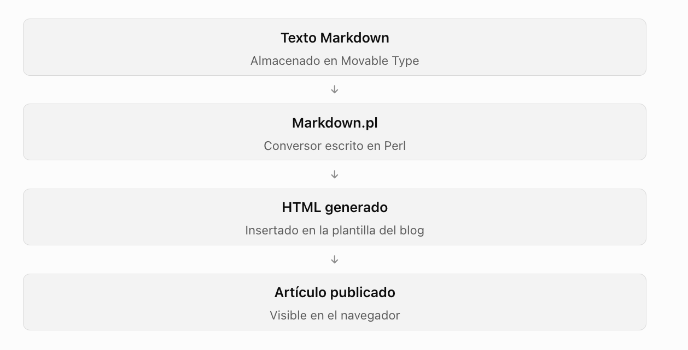

El proceso era automático, el usuario escribía el contenido y se generaba el fichero en HTML sin intervención del usuario.

Revisar: El sistema convertía automáticamente el contenido Markdown en HTML para mostrarlo en una página web. El documento original podía conservarse en formato Markdown

[Comprueba si puedes ver este fichero Markdown en GitHub](https://github.com/bitschips/ejercicios_html/blob/main/experimentos/README.md)

**Tarea**: Abre el archivo README.md del repositorio. Compara las opciones Code y Preview. ¿Dónde puedes ver las marcas originales de Markdown? ¿Dónde se representa el HTML generado? ¿Qué ocurre al consultar el código fuente de la página desde el navegador?

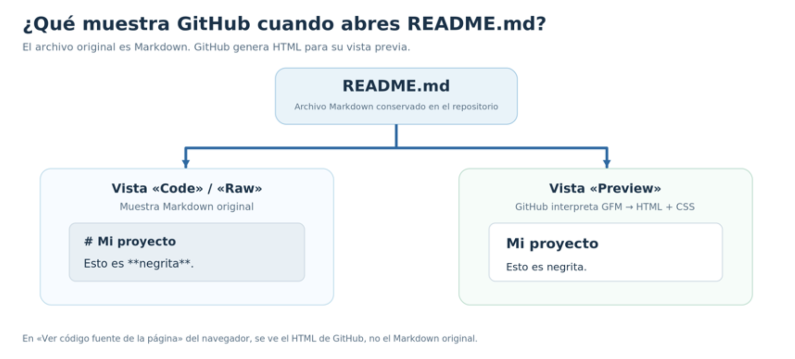

## Formatos previos a Markdown
Markdown no fue el primer lenguaje que permitió escribir documentos estructurados. Antes existían diversas soluciones, cada una con sus propias características.

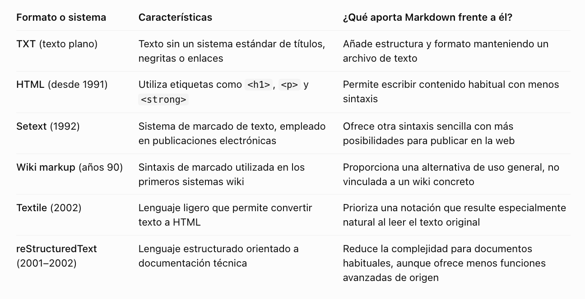

**Nota:** Markdown no sustituyó a estos lenguajes porque fueran incorrectos u obsoletos, de hecho, todavía se utilizan algunos de ellos. Su éxito se debió principalmente a encontrar un buen equilibrio entre sencillez, legibilidad y capacidad de conversión.

Ejemplo: Al escribir un correo en texto plano, los usuarios añadían caracteres para expresar formato:

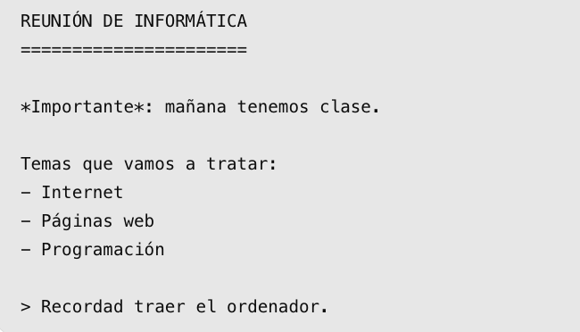

Markdown utilizó algunas de las convenciones de los usuarios y creó otras nuevas:

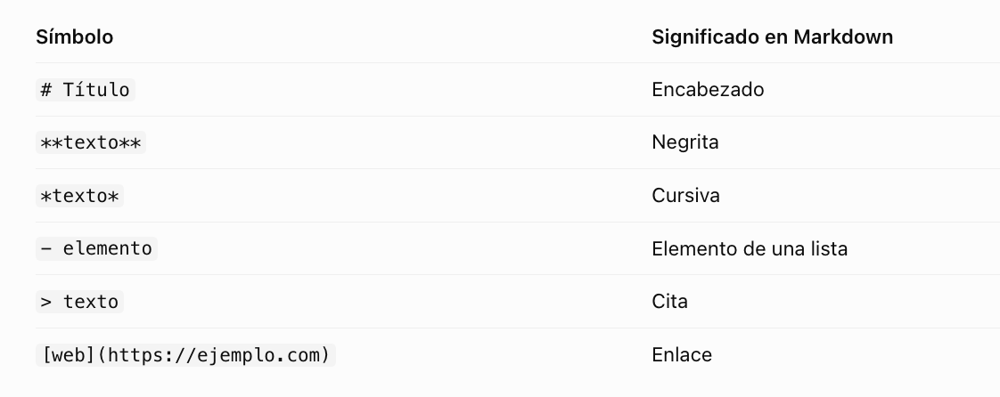

La siguiente imagen puede ayudarte a entender el objetivo de cada uno: **Markdown** ayuda a escribir y formatear, **HTML** ayuda a escribir para la web y **CSS** ayuda al diseño del código HTML.

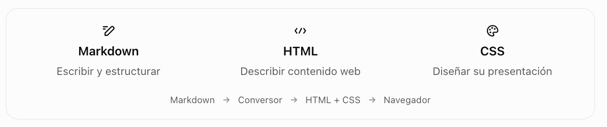

**Importante:**

- Markdown: lenguaje de marcado ligero para escribir documentos estructurados de forma sencilla y legible.
- HTML: lenguaje de marcado para definir la estructura y el significado del contenido de las páginas web.
- CSS: lenguaje de hojas de estilo para controlar la apariencia y distribución visual de páginas web.

**Nota:** ****CSS no es un lenguaje de marcado ni un lenguaje de programación de propósito general. Es un lenguaje declarativo de estilos.

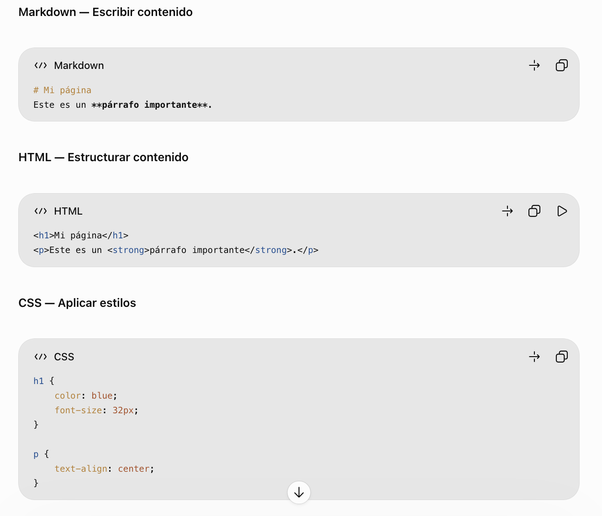

**Nota:** Observa la diferencia entre lenguaje de marcado, sencillo o complejo y lenguaje de estilos (CSS no utiliza marcas para delimitar contenido), en el último caso, no hay contenido que marcar, sólo son definiciones de diseño para el contenido HTML.

## ¿Qué problemas resuelve Markdown?
Lo vemos desde la perspectiva de alguien que quiere publicar una página web y debe usar etiquetas:

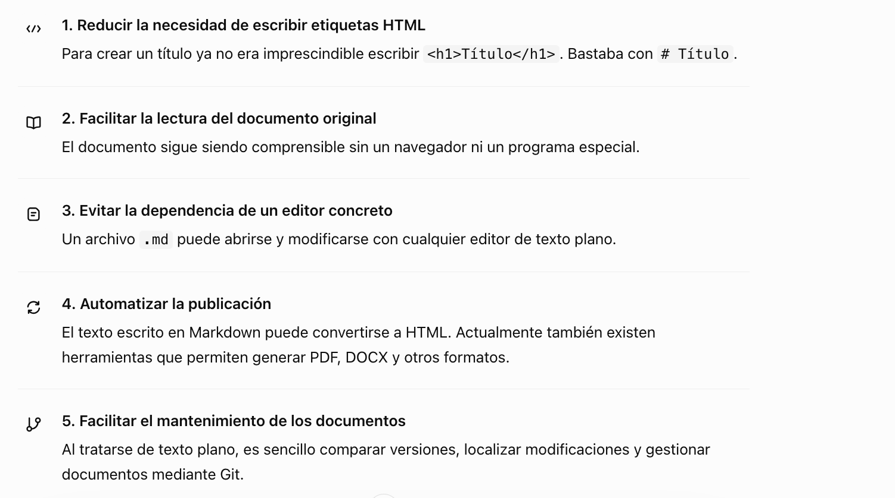

## Sintaxis y marcas de Markdown
Markdown no utiliza etiquetas como HTML (`<h1>`, `
`, etc.), sino marcas de formato que un conversor interpreta para generar HTML (es un proceso posterior que genera HTML que el usuario no ve)

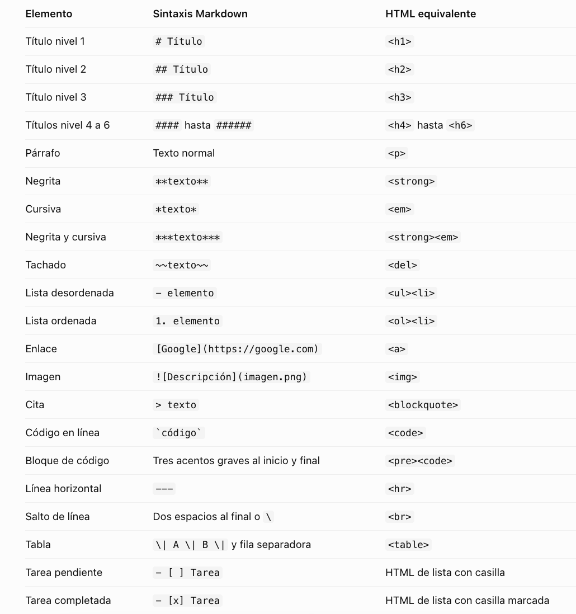

Algunas etiquetas HTML que puedes usar en GitHub:

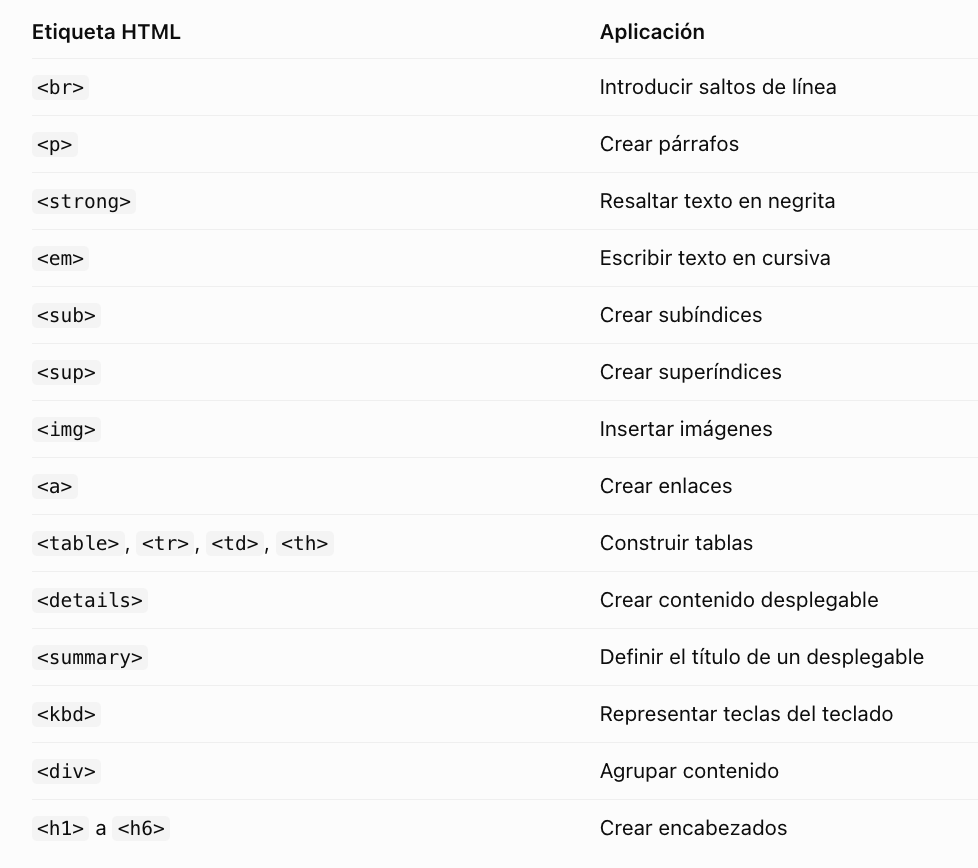

Etiquetas restringidas en Markdown en GitHub:

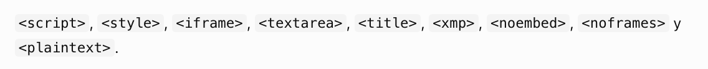

GitHub también filtra y sanea el HTML generado, por lo que aceptar una etiqueta durante el análisis de Markdown no garantiza que se conserve en el resultado visible.

- [Documentación de referencia GitHub Flavored Markdown](https://github.github.com/gfm/?utm_source=chatgpt.com)

**Recomendación final:** ****Distingue entre la sintaxis básica de Markdown, las extensiones de GitHub (GFM) y las etiquetas HTML adicionales. Markdown puede funcionar de forma diferente según el programa que lo interprete.

## Tareas:
Copia el siguiente código en alguno de los visores de Markdown online y comprueba que funciona correctamente, incluye enlaces también con etiquetas HTML `<a href=””>Link</a>` y verifica que los enlaces funcionan.

## Referencias
[Introducing Markdown](https://daringfireball.net/2004/03/introducing_markdown)

[Markdown tutorial](https://commonmark.org/help/)

## Editores online
- [https://dillinger.io/](https://dillinger.io/)
- [https://spec.commonmark.org/dingus/](https://spec.commonmark.org/dingus/)
- [https://stackedit.io/app](https://stackedit.io/app)
- [https://www.w3schools.com/tools/tool_markdown.php](https://www.w3schools.com/tools/tool_markdown.php)

> Investiga GitHub Flavored Markdown

## [Repaso examen](https://chatgpt.com/share/6af45a5a-9f2c-83eb-9eaa-ac5162c8a65b)
