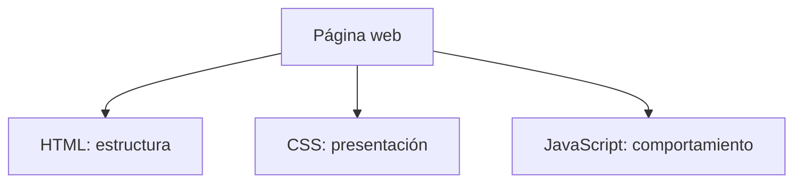

# Introducción a los lenguajes de marcas y HTML

> **Módulo:** Lenguajes de Marcas y Sistemas de Gestión de Información  
> **Unidad:** Introducción básica, etiquetas HTML, semántica y diseño responsive  

## Objetivos de aprendizaje

Al finalizar la unidad, el alumnado podrá:

1. Explicar qué es un lenguaje de marcas y relacionarlo con HTML.
2. Distinguir HTML, CSS y JavaScript.
3. Reconocer elementos, etiquetas y atributos HTML.
4. Clasificar etiquetas por su función y comprender su anidamiento.
5. Utilizar etiquetas semánticas para estructurar documentos.
6. Identificar las técnicas básicas para crear páginas adaptables a móviles.
7. Crear, ejecutar y modificar una página HTML sencilla.

---

## 1. ¿Qué es un lenguaje de marcas?

Un **lenguaje de marcas** utiliza marcas o etiquetas para identificar, organizar o describir partes de un documento o datos.

Sin marcas, un texto podría ser:

```text
Bienvenidos a mi página
Hoy aprenderemos HTML.
```

Con HTML, podemos indicar qué parte es un título y cuál es un párrafo:

```html
<h1>Bienvenidos a mi página</h1>
<p>Hoy aprenderemos HTML.</p>
```

El navegador reconoce las etiquetas y construye una representación del documento.

### Algunos lenguajes de marcas

| Lenguaje | Uso principal | Ejemplos |
|---|---|---|
| **HTML** | Estructurar contenido web | Títulos, párrafos, enlaces |
| **XML** | Representar e intercambiar datos estructurados | Facturas, configuraciones, documentos |
| **SVG** | Definir gráficos vectoriales | Iconos, diagramas |
| **MathML** | Representar expresiones matemáticas | Fórmulas y ecuaciones |
| **SGML** | Estándar histórico de marcado generalizado | Documentación técnica estructurada |

**Idea clave:** HTML es un lenguaje de marcas especializado en contenido web. No es un lenguaje de programación de propósito general.

---

## 2. HTML y su relación con CSS y JavaScript

**HTML** significa *HyperText Markup Language* (*Lenguaje de Marcado de Hipertexto*).

Una página web utiliza frecuentemente tres tecnologías complementarias:

| Tecnología | Para qué sirve | Ejemplo |
|---|---|---|
| **HTML** | Define la estructura y el contenido | Un título, un artículo, una imagen |
| **CSS** | Define la apariencia y la disposición visual | Colores, márgenes, columnas |
| **JavaScript** | Añade comportamiento e interactividad | Validar un formulario, responder a un clic |

**Analogía:** HTML define las habitaciones de una casa; CSS determina su aspecto; JavaScript permite que funcionen elementos interactivos, como persianas automáticas.



### Estructura mínima de un documento HTML

```html
<!DOCTYPE html>
<html lang="es">
<head>
    <meta charset="UTF-8">
    <title>Mi primera página</title>
</head>
<body>
    <h1>Hola, mundo</h1>
    <p>Mi primera página HTML.</p>
</body>
</html>
```

- `<!DOCTYPE html>`: declara el tipo de documento HTML moderno; **no es una etiqueta HTML**.
- `<html>`: elemento raíz.
- `<head>`: metadatos y recursos del documento.
- `<meta charset="UTF-8">`: indica la codificación de caracteres.
- `<title>`: título mostrado habitualmente en la pestaña del navegador.
- `<body>`: contenido principal visible de la página.

---

## 3. Etiquetas, elementos y atributos

### Etiquetas de apertura y cierre

```html
<p>Hola mundo</p>
```

| Parte | Significado |
|---|---|
| `<p>` | Etiqueta de apertura |
| `Hola mundo` | Contenido textual |
| `</p>` | Etiqueta de cierre |
| `<p>Hola mundo</p>` | Elemento completo |

### Elementos vacíos

No todos los elementos llevan etiqueta de cierre:

```html

<br>
<hr>
<input type="text">
```

Estos son **elementos vacíos** (*void elements*), que no contienen otros nodos en su interior.

### Anidamiento de elementos

```html
<section>
    <h2>Noticias</h2>
    <p>Últimas novedades.</p>
</section>
```

Los elementos crean una estructura jerárquica. Conviene cerrar las etiquetas en el orden correcto.

### Los atributos aportan información adicional

```html
<a href="https://example.com" target="_blank" rel="noopener">
    Visitar una web
</a>
```

- `<a>` es la etiqueta que marca un enlace.
- `href` indica la dirección de destino.
- `target="_blank"` solicita abrirlo en otro contexto de navegación, normalmente otra pestaña.
- `rel="noopener"` evita que la página de destino acceda a la página de origen mediante `window.opener`.

**No confundir:** `href`, `src`, `alt`, `class`, `id` y `style` son **atributos**, no etiquetas.

---

## 4. Tipos de etiquetas HTML según su función

| Categoría | Etiquetas habituales | Función |
|---|---|---|
| Estructura | `<html>`, `<head>`, `<body>` | Organización general |
| Encabezados y texto | `<h1>`…`<h6>`, `<p>` | Títulos y párrafos |
| Significado del texto | `<strong>`, `<em>`, `<mark>` | Importancia, énfasis y resaltado |
| Enlaces y medios | `<a>`, ``, `<video>`, `<audio>` | Navegación y multimedia |
| Listas | `<ul>`, `<ol>`, `<li>` | Listas sin orden y ordenadas |
| Tablas | `<table>`, `<tr>`, `<th>`, `<td>` | Datos tabulares |
| Formularios | `<form>`, `<label>`, `<input>`, `<button>` | Recogida de datos |
| Contenedores genéricos | `<div>`, `<span>` | Agrupación sin significado específico |
| Estructura semántica | `<header>`, `<nav>`, `<main>`, `<article>`, `<section>`, `<aside>`, `<footer>` | Significado de las regiones de la página |

### Ejemplos breves

```html
<h1>Título principal</h1>
<p>Este es un párrafo con <strong>información importante</strong>.</p>

<ul>
    <li>HTML</li>
    <li>CSS</li>
</ul>


<button type="button">Pulsar</button>
```

**Accesibilidad:** el atributo `alt` describe una imagen cuando aporta información; si es puramente decorativa, puede usarse `alt=""`.

---

## 5. HTML semántico: etiquetas que aportan significado

Una etiqueta **semántica** expresa qué representa una parte del contenido, no solo cómo se agrupa.

Por ejemplo, este código agrupa texto pero no explica su función:

```html
<div>Noticias de tecnología</div>
```

En cambio, este otro identifica explícitamente una sección temática y su título:

```html
<section>
    <h2>Noticias de tecnología</h2>
</section>
```

### Principales elementos semánticos

| Etiqueta | Significado habitual |
|---|---|
| `<header>` | Cabecera de una página o sección |
| `<nav>` | Bloque de enlaces de navegación |
| `<main>` | Contenido principal del documento |
| `<section>` | Sección temática, normalmente con encabezado |
| `<article>` | Contenido independiente o reutilizable, como una noticia |
| `<aside>` | Contenido relacionado o complementario |
| `<footer>` | Pie de página o de una sección |
| `<figure>` y `<figcaption>` | Figura y leyenda asociada |
| `<time>` | Fecha u hora interpretable por máquinas |

### Esquema orientativo

```text
PÁGINA
├── header  → Cabecera
├── nav     → Menú de navegación
├── main    → Contenido principal
│   ├── section → Grupo temático
│   │   ├── article → Contenido independiente
│   │   └── article → Otro contenido independiente
│   └── aside → Contenido complementario
└── footer  → Pie de página
```

> **Nota:** este esquema es ilustrativo, no una jerarquía obligatoria. Por ejemplo, `aside` también puede estar fuera de `main`, según la información que contenga.

### Ventajas del HTML semántico

1. **Accesibilidad:** puede facilitar la navegación con tecnologías de apoyo.
2. **Mantenimiento:** mejora la lectura y comprensión del código.
3. **Interpretación del contenido:** permite reconocer regiones y relaciones estructurales.
4. **Desarrollo colaborativo:** hace más predecible la estructura del documento.

La semántica es importante, pero **no garantiza por sí sola** mejores posiciones en buscadores ni una presentación responsive.

---

## 6. ¿Qué significa responsive?

Una página con **diseño responsive** adapta su disposición visual al ancho disponible, de modo que resulte utilizable en móviles, tabletas y ordenadores.

```text
ORDENADOR (pantalla ancha)       MÓVIL (pantalla estrecha)
┌───────────────────────┐        ┌──────────┐
│        CABECERA       │        │ CABECERA │
├───────────┬───────────┤        ├──────────┤
│ Artículo 1│ Artículo 2│        │Artículo 1│
├───────────┴───────────┤        ├──────────┤
│         PIE           │        │Artículo 2│
└───────────────────────┘        ├──────────┤
                                 │   PIE    │
                                 └──────────┘
```

**Importante:** responsive **no** es un tipo especial de etiqueta HTML. Normalmente se consigue con CSS (por ejemplo, `grid`, `flex` y reglas `@media`), junto con HTML bien estructurado.

### Elementos y atributos relacionados

| Elemento o atributo | Para qué sirve | ¿Etiqueta o atributo? |
|---|---|---|
| `<meta name="viewport">` | Configura el viewport del dispositivo | Etiqueta `<meta>` con atributos |
| `<picture>` | Agrupa fuentes alternativas para una imagen | Etiqueta |
| `<source>` | Define una fuente alternativa de imagen o multimedia | Etiqueta |
| `` | Inserta una imagen | Etiqueta |
| `srcset` | Ofrece varias versiones de una imagen | Atributo |
| `sizes` | Describe el tamaño de presentación previsto | Atributo |
| `media` | Indica una condición de medios | Atributo |
| `<link>` | Puede asociar una hoja de estilos | Etiqueta |
| `@media` | Aplica estilos CSS según condiciones | **Regla de CSS, no etiqueta** |

### Ejemplo A. Configuración del viewport

En el `<head>`:

```html
<meta name="viewport" content="width=device-width, initial-scale=1">
```

Esto indica al navegador móvil que utilice el ancho del dispositivo como referencia inicial y una escala de 1.

### Ejemplo B. Imágenes adaptables con `<picture>`

```html
<picture>
    <source media="(max-width: 600px)" srcset="foto-movil.jpg">
    
</picture>
```

El navegador puede escoger la imagen para móvil si se cumple la condición `max-width: 600px`; en caso contrario utiliza la imagen de reserva.

### Ejemplo C. Dos columnas que pasan a una

```css
.contenedor {
    display: grid;
    grid-template-columns: 1fr 1fr;
    gap: 20px;
}

@media (max-width: 600px) {
    .contenedor {
        grid-template-columns: 1fr;
    }
}
```

Con un ancho de viewport superior a 600 píxeles, el contenedor tiene dos columnas; con 600 píxeles o menos, una sola.

---

## 7. Práctica guiada: nuestra primera página semántica y responsive

**Instrucciones:** crea una carpeta de trabajo y guarda el siguiente contenido en un archivo llamado `index.html`. Ábrelo con un navegador y prueba a cambiar el ancho de la ventana.

```html
<!DOCTYPE html>
<html lang="es">
<head>
    <meta charset="UTF-8">
    <meta name="viewport" content="width=device-width, initial-scale=1">
    <title>Mi primera web</title>

    <style>
        body {
            font-family: Arial, sans-serif;
            margin: 0;
            background: #f1f5f9;
        }

        header, footer {
            background: #17416b;
            color: white;
            padding: 20px;
            text-align: center;
        }

        nav {
            background: #dbeafe;
            padding: 15px;
            text-align: center;
        }

        nav a {
            margin: 10px;
        }

        main {
            display: grid;
            grid-template-columns: 1fr 1fr;
            gap: 20px;
            padding: 20px;
        }

        article {
            background: white;
            padding: 20px;
            border-radius: 10px;
        }

        @media (max-width: 600px) {
            main {
                grid-template-columns: 1fr;
            }
        }
    </style>
</head>

<body>
    <header>
        <h1>Mi primera web HTML</h1>
        <p>Aprendiendo lenguajes de marcas</p>
    </header>

    <nav>
        <a href="#html">HTML</a>
        <a href="#responsive">Responsive</a>
    </nav>

    <main>
        <article id="html">
            <h2>¿Qué es HTML?</h2>
            <p>Es un lenguaje de marcas utilizado
               para crear páginas web.</p>
        </article>

        <article id="responsive">
            <h2>Diseño responsive</h2>
            <p>Esta página se adapta al tamaño
               de tu pantalla.</p>
        </article>
    </main>

    <footer>
        <p>Lenguajes de Marcas - 1.º DAW</p>
    </footer>
</body>
</html>
```

### Preguntas para observar el resultado

1. ¿Qué partes del código pertenecen a HTML y cuáles a CSS?
2. ¿Dónde aparece el contenido de `<title>`? ¿Y el de `<h1>`?
3. ¿Qué sucede al estrechar la ventana del navegador?
4. ¿Qué ocurre si cambiamos `600px` por `800px`?
5. ¿Por qué los enlaces del menú contienen `#html` y `#responsive`?
6. ¿Qué sucede si eliminamos el atributo `id` de uno de los artículos?

---

## 8. Curiosidades sobre HTML

1. **HTML nació para compartir información científica.** Tim Berners-Lee impulsó la World Wide Web en el CERN a finales de la década de 1980 y comienzos de la de 1990.
2. **La primera web era principalmente texto con enlaces.** Puedes explorar una reconstrucción histórica en [info.cern.ch](https://info.cern.ch/).
3. **El navegador intenta reparar ciertos errores.** Si faltan algunas etiquetas, el analizador HTML puede reconstruir el árbol del documento, aunque el resultado no siempre sea el esperado.
4. **Las etiquetas HTML no distinguen mayúsculas y minúsculas en documentos HTML.** `<P>` y `<p>` representan el mismo tipo de elemento. Se recomienda escribirlas en minúscula.
5. **No todas las etiquetas generan contenido visible.** `<meta>` y `<title>`, por ejemplo, aportan información al documento o al navegador sin mostrarse como un párrafo en la página.
6. **HTML sigue evolucionando.** El estándar actual se mantiene como el *HTML Living Standard*.
7. **HTML y XML comparten la idea de marcado, pero no sus reglas.** En XML las etiquetas distinguen mayúsculas y minúsculas y todos los elementos deben cerrarse correctamente; HTML tiene reglas propias de análisis y elementos vacíos.
8. **No todo lo que parece una etiqueta lo es.** `<!DOCTYPE html>` es una declaración; `@media` pertenece a CSS; `href` y `src` son atributos.

---

## 9. Actividad:

**Título:** Descubriendo HTML: estructura, semántica y diseño responsive  
**Duración orientativa:** 50–60 minutos  
**Entrega sugerida:** un documento con respuestas y el archivo `index.html` modificado.

### Tareas

- [ ] **1. Investigación inicial.** Explica qué significa HTML y cuál es su relación con los lenguajes de marcas.
- [ ] **2. Clasificación.** Identifica 10 etiquetas HTML y clasifícalas según su finalidad.
- [ ] **3. Conceptos.** Explica la diferencia entre *etiqueta*, *elemento* y *atributo*, utilizando un ejemplo de cada uno.
- [ ] **4. Semántica.** Investiga cinco etiquetas semánticas y explica cuándo se utilizarían.
- [ ] **5. Primera ejecución.** Copia la página de la sección 7 en `index.html` y ábrela en un navegador.
- [ ] **6. Personalización.** Cambia títulos, textos y colores.
- [ ] **7. Prueba responsive.** Reduce el ancho de la ventana, modifica la condición `@media` y describe los cambios.
- [ ] **8. Investigación adicional.** Explica la utilidad de `viewport`, `<picture>` y `srcset`, distinguiendo etiquetas y atributos.

### Cuestionario de repaso

**1. ¿Qué etiqueta identifica el contenido principal de la página?**

- A. `<div>`
- B. `<main>`
- C. `<span>`

**2. ¿Qué tecnología controla principalmente la distribución responsive en columnas?**

- A. CSS
- B. XML
- C. SQL

**3. ¿Qué es `href` en un enlace?**

- A. Una etiqueta
- B. Un atributo
- C. Un lenguaje

**4. ¿Qué elemento permite definir diferentes fuentes de imagen según condiciones?**

- A. `<footer>`
- B. `<strong>`
- C. `<picture>`

<details>
<summary>Mostrar soluciones del cuestionario</summary>

1. **B — `<main>`**: identifica el contenido principal del documento.
2. **A — CSS**: con Grid, Flexbox y media queries se controla la disposición visual.
3. **B — Atributo**: `href` indica la URL de destino de un enlace.
4. **C — `<picture>`**: permite proporcionar fuentes de imagen alternativas mediante `<source>`.

</details>

---

## 10. Glosario:

| Término | Definición |
|---|---|
| Lenguaje de marcas | Sistema de marcas para representar estructura o significado de información |
| HTML | Lenguaje de marcado de hipertexto para contenido web |
| Etiqueta | Marca sintáctica como `<p>` o `</p>` |
| Elemento | Unidad de la estructura HTML, como un párrafo completo |
| Atributo | Información adicional incluida en la etiqueta de apertura |
| Anidamiento | Inclusión de unos elementos dentro de otros |
| Semántica | Significado de un elemento o contenido |
| DOM | Representación en árbol de un documento que utiliza el navegador |
| Responsive | Diseño que se adapta al espacio de visualización disponible |
| Viewport | Área de referencia de visualización de una página |
| Media query | Condición de CSS para aplicar estilos según características del dispositivo o entorno |
| Accesibilidad | Diseño para que el contenido sea utilizable por personas con distintas capacidades |

---

## 11. Recursos para ampliar

- [MDN Web Docs: HTML](https://developer.mozilla.org/es/docs/Web/HTML)
- [MDN: diseño web adaptable](https://developer.mozilla.org/es/docs/Learn_web_development/Core/CSS_layout/Responsive_Design)
- [MDN: imágenes adaptables](https://developer.mozilla.org/en-US/docs/Web/HTML/Guides/Responsive_images)
- [WHATWG: HTML Living Standard](https://html.spec.whatwg.org/)
- [Validador HTML del W3C](https://validator.w3.org/)
- [La primera web — CERN](https://info.cern.ch/)

---

## Secuencia didáctica recomendada

| Sesión | Contenidos | Producto o evidencia |
|---|---|---|
| **I** | Lenguajes de marcas, HTML, estructura, etiquetas y atributos | Identificación de elementos y pequeños ejemplos |
| **II** | Clasificación de etiquetas, HTML semántico y accesibilidad | Esquema semántico de una página |
| **III** | Viewport, imágenes responsive, CSS y media queries | `index.html` funcional y personalizado |

> **Para el repositorio:** si este archivo se renombra a `README.md` y se coloca en la raíz de un repositorio de GitHub, su contenido aparecerá automáticamente en la portada del repositorio. GitHub también representa las tablas, los diagramas Mermaid y los bloques desplegables incluidos aquí.
